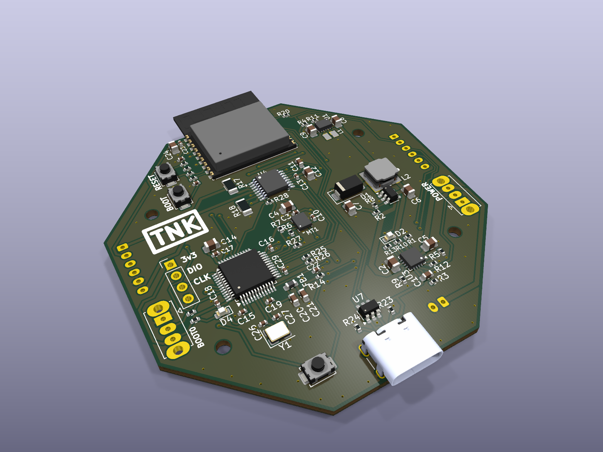
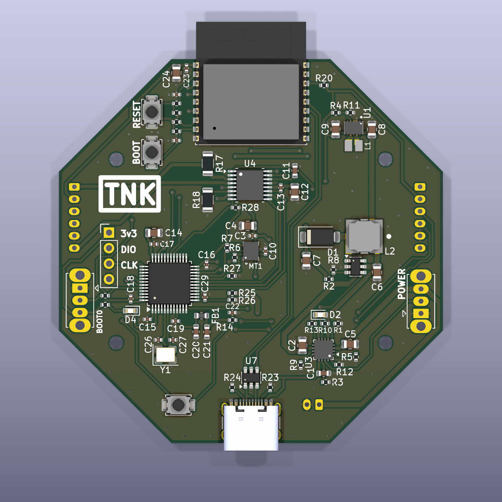
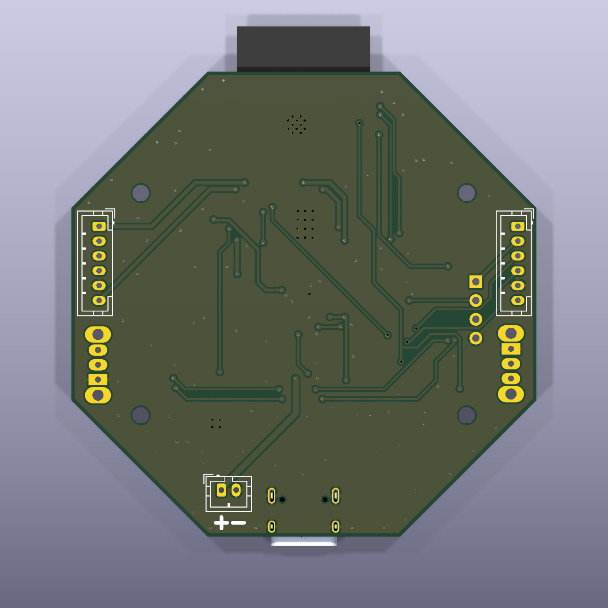
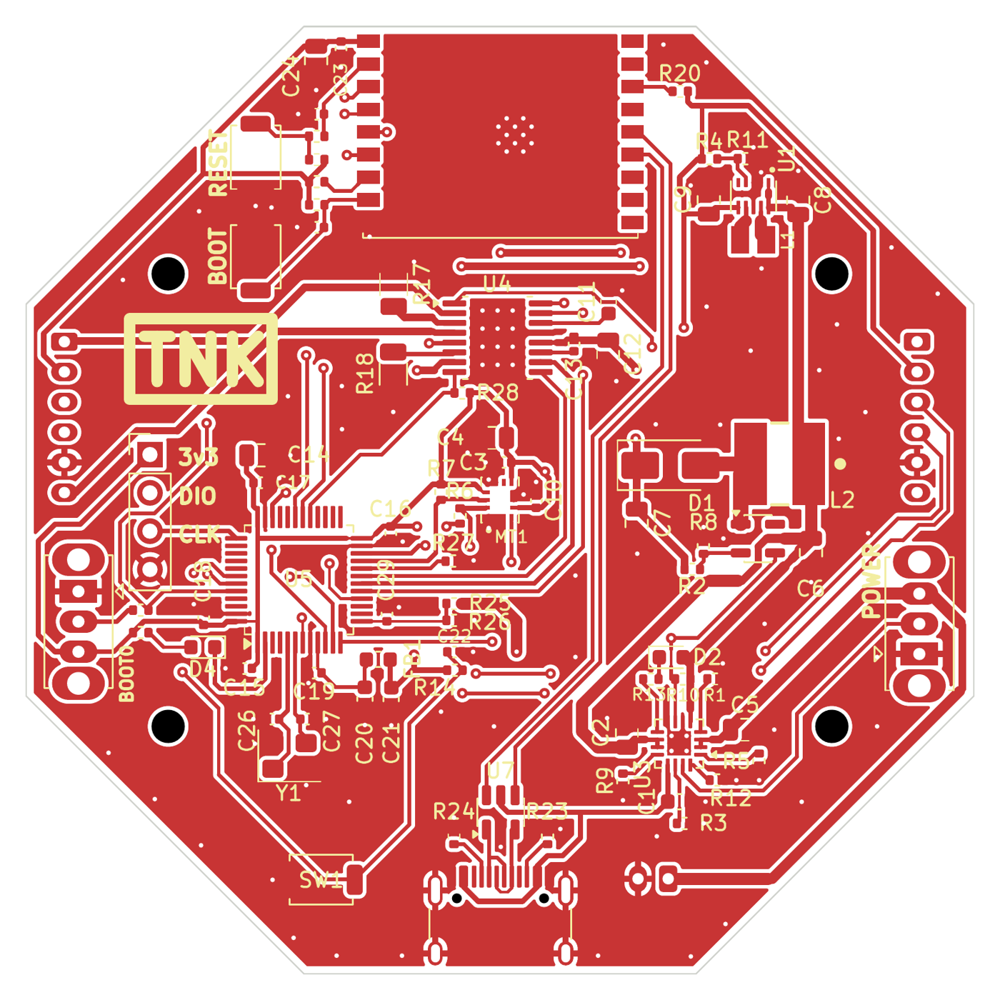
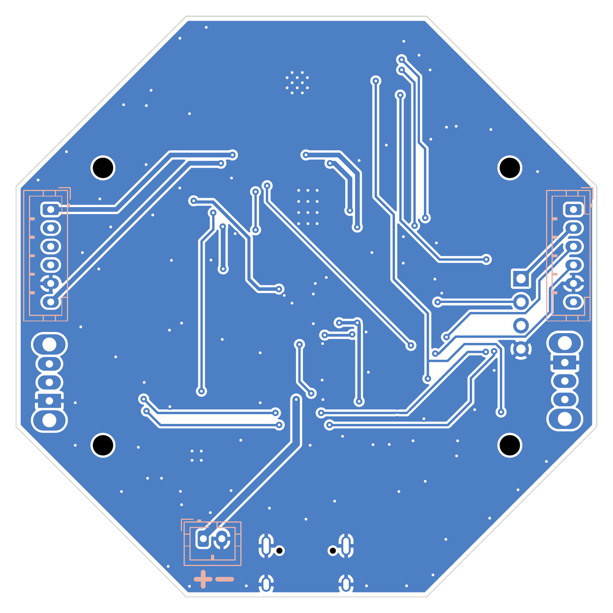

# Swarm Robot – Hardware

Mạch điều khiển cho robot bầy đàn (swarm robot), thiết kế bằng **KiCad 10**.

Một mạch duy nhất gồm hai vi điều khiển:
- **STM32F103C8T6**: điều khiển thời gian thực. Lo 2 động cơ có encoder, IMU 6 trục và đo điện áp pin.
- **ESP32-C3-WROOM-02**: truyền thông không dây giữa các robot. Chip này cũng nạp firmware cho STM32 qua UART.

> 🔗 Firmware: [Swarm_Robot_Firmware](https://github.com/Khoi281248/Swarm_Robot_Firmware)
> 📄 Sơ đồ nguyên lý dạng PDF (xem không cần KiCad): [Swarm_robot_project.pdf](Swarm_robot_project.pdf)



| Mặt trên (3D) | Mặt dưới (3D) |
|---|---|
|  |  |

*Ảnh render 3D từ KiCad 10. Linh kiện xuyên lỗ J1–J4, SW3, SW5 là DNP (tự hàn) nên không hiện model 3D.*

<details>
<summary>Đi dây lớp đồng (bấm để xem)</summary>

| Lớp trên F.Cu | Lớp dưới B.Cu (nhìn từ dưới) |
|---|---|
|  |  |

</details>

## Thông số mạch

| Thông số | Giá trị |
|---|---|
| Kích thước | 62,8 × 62,8 mm, hình bát giác |
| Số lớp | 2 lớp (F.Cu tín hiệu, B.Cu nguồn/GND), dày 1,6 mm |
| Lỗ bắt vít | 4 lỗ M2 (H1–H4) |
| Nguồn | Pin LiPo 1S (2000 mAh), sạc qua USB-C |
| Linh kiện | 87 footprint: 77 linh kiện SMD lắp tại JLCPCB, 6 linh kiện xuyên lỗ tự hàn (J1–J4, SW3, SW5), 4 lỗ vít |

## Sơ đồ khối

```
 USB-C (J5) ──┬── D+/D- ── USBLC6 (U7) ──────────────► ESP32-C3 (USB Serial/JTAG)
              │
              └── VBUS ──► BQ24075 (U3) ◄──► Pin LiPo 1S (J4)
                           sạc + power-path
                                │ VOUT   (SW5: bật/tắt nguồn)
                  ┌─────────────┴──────────────┐
                  ▼                            ▼
          TPS63802 (U1)                 MT3608 (U2) + SS34 (D1)
          buck-boost → +3,3 V           boost → +6 V
                  │                            │
   STM32, ESP32-C3, IMU, encoder         DRV8833 (U4) ──► Motor A (J1), Motor B (J2)

   ESP32-C3 ── UART (TX_ESP / RX_ESP) ──► STM32F103 ── I2C ──► ICM-42670-P (MT1)
   ESP32-C3 ── NRST, BOOT0 ────────────► STM32F103 ── PWM ──► DRV8833
                                         STM32F103 ◄── encoder A/B ── J1, J2
```

## Linh kiện chính

| Ký hiệu | Linh kiện | Chức năng | Mã LCSC |
|---|---|---|---|
| U5 | STM32F103C8T6 | Vi điều khiển chính, thạch anh 16 MHz (Y1) | C8734 |
| U6 | ESP32-C3-WROOM-02 | Wi-Fi / ESP-NOW, nạp code qua USB-C | C2934560 |
| U4 | DRV8833PWP | Driver 2 động cơ DC, giới hạn dòng khoảng 1 A/kênh (R17, R18 = 0,2 Ω) | C50506 |
| MT1 | ICM-42670-P | IMU 6 trục (gia tốc + con quay), giao tiếp I2C | C3288646 |
| U3 | BQ24075RGT | Sạc pin LiPo 1S có power-path | C15464 |
| U1 | TPS63802DLAR | Buck-boost tạo +3,3 V | C2845237 |
| U2 | MT3608 | Boost tạo +6 V cho động cơ | C84817 |
| U7 | USBLC6-2SC6 | Chống tĩnh điện (ESD) cho đường USB | C7519 |

Danh sách đầy đủ: [production/BOM_JLCPCB.csv](production/BOM_JLCPCB.csv).

## Đầu nối, nút bấm, đèn

| Ký hiệu | Loại | Chức năng |
|---|---|---|
| J1, J2 | JST PH 6 chân 2,0 mm | Motor A, Motor B: 2 dây động cơ, 3,3 V, GND, encoder A/B |
| J3 | Header 4 chân 2,54 mm | SWD nạp/debug STM32: 3,3 V, SWDIO, SWCLK, GND |
| J4 | JST PH 2 chân 2,0 mm | Pin LiPo 1S |
| J5 | USB-C | Sạc pin, nạp code và debug ESP32-C3 |
| SW1 | Nút nhấn | Reset STM32 (NRST) |
| SW2 | Nút nhấn | Reset ESP32-C3 (EN) |
| SW3 | Công tắc gạt | Chọn BOOT0 của STM32 (chạy chương trình / bootloader) |
| SW4 | Nút nhấn | BOOT ESP32-C3 (IO9), giữ khi reset để vào chế độ nạp |
| SW5 | Công tắc gạt | Bật/tắt nguồn (chân SYSOFF của BQ24075) |
| D2 | LED đỏ | Báo có nguồn |
| D4 | LED đỏ | LED do STM32 điều khiển |

Sơ đồ chân vi điều khiển và cấu hình ngoại vi: xem `stm32/docs/CAU_HINH.md` và `esp32/docs/CAU_HINH.md` trong repo [firmware](https://github.com/Khoi281248/Swarm_Robot_Firmware).

## Mở project

1. Cài **KiCad 10** trở lên. File được lưu bằng KiCad 10.0.7, nên KiCad 9 trở xuống không mở được.
2. Clone repo:
   ```bash
   gh repo clone Khoi281248/Swarm_Robot_Hardware
   ```
3. Mở `Swarm_robot_project.kicad_pro` bằng KiCad.

Thư viện riêng của project được khai báo bằng đường dẫn tương đối `${KIPRJMOD}/Libraries/...` trong `sym-lib-table` và `fp-lib-table`. Vì vậy **không cần cài thêm thư viện**. Model 3D chuẩn lấy từ thư viện có sẵn của KiCad 10.

## Cấu trúc thư mục

```
Swarm_Robot_Hardware/
├── Swarm_robot_project.kicad_pro   Project KiCad
├── Swarm_robot_project.kicad_sch   Sơ đồ nguyên lý
├── Swarm_robot_project.kicad_pcb   Mạch in (PCB)
├── Swarm_robot_project.pdf         Sơ đồ nguyên lý dạng PDF
├── sym-lib-table, fp-lib-table     Khai báo thư viện riêng của project
├── Libraries/
│   ├── Symble/                     Symbol riêng (DRV8833, ICM-42670-P, TPS63802...)
│   ├── Footprint.pretty/           Footprint riêng
│   └── 3D_models/                  Model 3D (.step) riêng
├── production/
│   ├── BOM_JLCPCB.csv              Danh sách linh kiện kèm mã LCSC
│   └── CPL_JLCPCB.csv              Toạ độ đặt linh kiện
├── Datasheet/                      Datasheet PDF của các IC chính
└── docs/                           Ảnh PCB, logo
```

## Datasheet

Bản PDF lưu trong thư mục [`Datasheet/`](Datasheet/) để tra cứu nhanh, đúng phiên bản nhóm đã dùng khi thiết kế. Bản mới nhất có thể tải từ trang của hãng (bản quyền thuộc về hãng sản xuất):

| Linh kiện | Trong repo | Trang hãng |
|---|---|---|
| STM32F103C8 | [DS_stm32f103c8.pdf](Datasheet/DS_stm32f103c8.pdf) | [Datasheet](https://www.st.com/resource/en/datasheet/stm32f103c8.pdf) |
| STM32F103 (reference manual RM0008) | [rm0008-...pdf](Datasheet/rm0008-stm32f101xx-stm32f102xx-stm32f103xx-stm32f105xx-and-stm32f107xx-advanced-armbased-32bit-mcus-stmicroelectronics.pdf) | [RM0008](https://www.st.com/resource/en/reference_manual/rm0008-stm32f101xx-stm32f102xx-stm32f103xx-stm32f105xx-and-stm32f107xx-advanced-armbased-32bit-mcus-stmicroelectronics.pdf) |
| ESP32-C3-WROOM-02 | [esp32-c3-wroom-02_datasheet_en.pdf](Datasheet/esp32-c3-wroom-02_datasheet_en.pdf) | [Datasheet](https://www.espressif.com/sites/default/files/documentation/esp32-c3-wroom-02_datasheet_en.pdf) |
| DRV8833 | [drv8833.pdf](Datasheet/drv8833.pdf) | [Datasheet](https://www.ti.com/lit/ds/symlink/drv8833.pdf) |
| BQ24075 (cùng họ BQ2407x) | [bq24074.pdf](Datasheet/bq24074.pdf) | [Datasheet](https://www.ti.com/lit/ds/symlink/bq24075.pdf) |
| TPS63802 | [tps63802.pdf](Datasheet/tps63802.pdf) | [Datasheet](https://www.ti.com/lit/ds/symlink/tps63802.pdf) |
| ICM-42670-P | [DS-000451-ICM-42670-P-v1.0.pdf](Datasheet/DS-000451-ICM-42670-P-v1.0.pdf) | [Trang sản phẩm TDK](https://invensense.tdk.com/products/motion-tracking/6-axis/icm-42670-p/) |
| MT3608 | [MT3608.pdf](Datasheet/MT3608.pdf) | [LCSC C84817](https://www.lcsc.com/product-detail/C84817.html) |
| USBLC6-2SC6 | – | [Datasheet](https://www.st.com/resource/en/datasheet/usblc6-2.pdf) |

## Làm việc nhóm

1. **Mỗi lúc chỉ một người sửa file `.kicad_pcb`.** Hai bản PCB sửa song song gần như không gộp được. Báo cả nhóm trước khi bắt đầu route.
2. Commit message bắt đầu bằng phần bị sửa:
   - `sch:` sơ đồ nguyên lý
   - `pcb:` mạch in
   - `lib:` thư viện
   - `prod:` file sản xuất
   - `docs:` tài liệu

   Ví dụ: `pcb: sua 2 loi DRC clearance gan U4`.
3. Sửa sơ đồ nguyên lý xong thì **xuất lại PDF** (*File → Plot → PDF*), commit cùng lúc.
4. Thêm linh kiện mới: đặt symbol, footprint, model 3D vào `Libraries/` và dẫn đường dẫn bằng `${KIPRJMOD}`. **Không trỏ tới file nằm ngoài repo.**
5. Chạy **ERC** (sơ đồ) và **DRC** (PCB) trước khi push, đảm bảo không có lỗi mới.
6. Khi gửi mạch đi sản xuất:
   - Xuất lại BOM/CPL vào `production/`.
   - Tạo GitHub **Release** (ví dụ `v1.0`) và đính kèm file Gerber `.zip`. Gerber không commit vào repo.

## Tiến độ

| Hạng mục | Trạng thái |
|---|---|
| Sơ đồ nguyên lý | ✅ Xong |
| Bố trí linh kiện | ✅ Xong |
| Đi dây (routing) | ✅ Xong (2 lớp, 135 via, 0 chân chưa nối) |
| Kiểm tra DRC | ✅ Không còn lỗi, schematic và PCB đồng bộ |
| Xuất Gerber, BOM, CPL | ✅ Xong (Gerber đính kèm ở mục Releases) |
| Đặt mạch JLCPCB, lắp ráp, test | ⏳ Chưa làm |

## Giấy phép

Thiết kế phát hành theo giấy phép [MIT](LICENSE). Giấy phép MIT **không áp dụng** cho datasheet trong `Datasheet/` và thư viện, model 3D của hãng; các tài liệu này thuộc bản quyền của nhà sản xuất.
